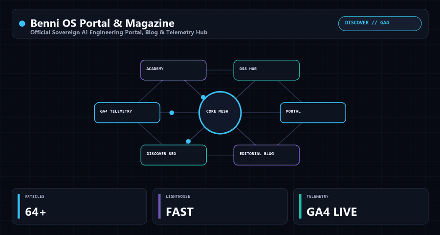

 

 

> **Official Sovereign AI Engineering Portal, Blog & Telemetry Hub.**  
> Part of the **Benni Master OS** sovereign engineering ecosystem.

 

---

## ⚡ Overview

**Benni OS Portal & Magazine** — Official Sovereign AI Engineering Portal, Blog & Telemetry Hub.

### Architecture Highlights
- **Nodes:** PORTAL · EDITORIAL BLOG · DISCOVER SEO · GA4 TELEMETRY · ACADEMY · OSS HUB
- **Ecosystem:** Native integration with **Benni Master OS** (`benni-os.net`).
